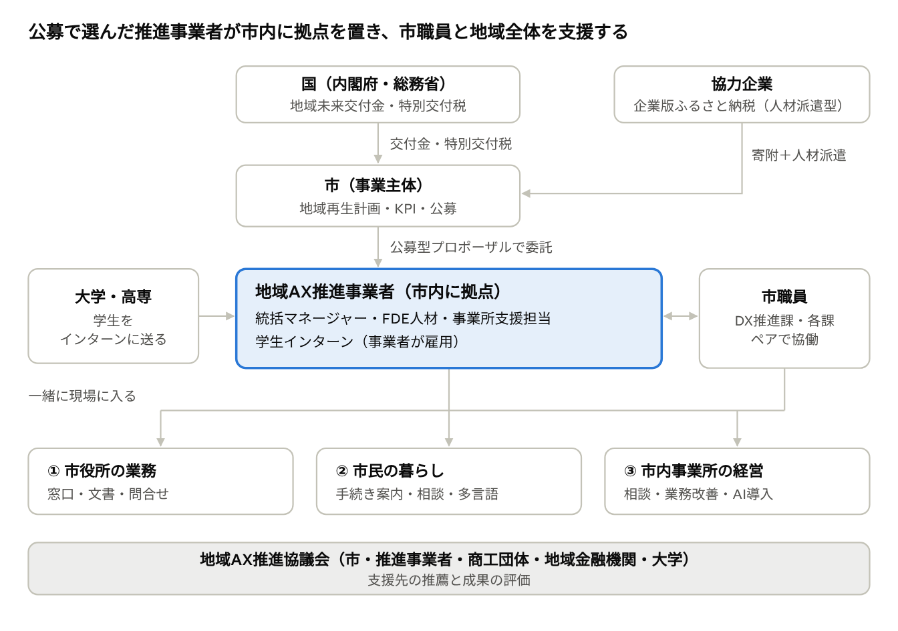
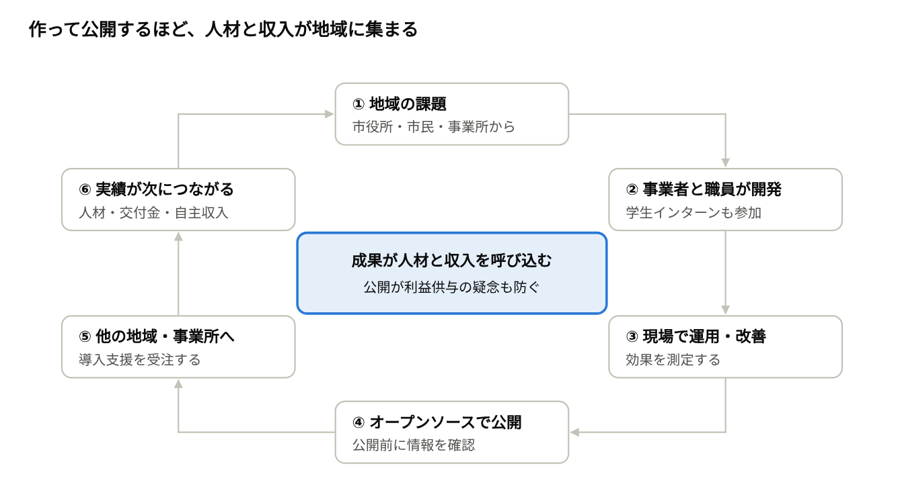

# 地域AX推進事業（仮称）企画案

2026年11月19日時点 · 庁内協議用たたき台

## 1. 企画の概要

市が事業主体となり、公募で選んだ「地域AX推進事業者」が市役所内または市内に拠点を置く。事業者は市職員と一緒に、市役所の業務、市民の暮らし、市内事業所の経営をAIで改善する。財源は地域未来交付金を中心に、特別交付税と企業版ふるさと納税を組み合わせる。作った仕組みはオープンソースで公開し、他の地域にも広げる。

市役所で確かめた仕組みを市民と事業所に広げる。3つの領域を同じ推進体制と財源が支える。

**AX（AIトランスフォーメーション）とは**：AIを使って、仕事や暮らしのやり方そのものを変えること。現場に入ってその場で仕組みを作る技術者を、本企画ではFDE（フォワード・デプロイド・エンジニア）と呼ぶ。

**前案からの変更点**

| 項目 | 前案 | 本案 |
| --- | --- | --- |
| 対象 | 市役所の中の業務 | 地域社会全般（市役所・市民生活・市内事業所） |
| 実施体制 | 市役所内のFDE班 | 公募で選んだ地域AX推進事業者が市内に拠点を置き、市職員と協働 |
| 学生 | 市が会計年度任用職員として雇用 | 事業者が雇用または籍を置き、市の事業に参加 |
| 主な財源 | 特別交付税（人件費） | 地域未来交付金（委託費）＋特別交付税（市側の人材）＋企業版ふるさと納税 |
| 成果指標 | 業務時間の削減など | 上記に加え、支援した事業所の数、市民サービスの利用者数、市内での雇用・定着 |

**背景**

- 市役所だけでなく、市内の中小事業所も人手とデジタル人材が不足している。市と事業所が別々に外部人材を探すより、地域で共同して抱える方が効率がよい。
- 地域未来交付金は地域の課題解決と地域経済への効果を重視する。対象を市民と事業所まで広げることで、交付金の趣旨に合う事業になる。
- 総務省は地域の課題整理やAI導入計画の策定を伴走支援する「地域AX」の取組を進めている。デジタル庁は職員向け生成AI環境「源内」の一部をオープンソースで公開しており（2026年4月）、国の方向性と一致する。

## 2. 事業スキーム

市が地域再生計画をつくって国の交付金を受け、公募型プロポーザルで選んだ推進事業者に委託する。市が特定の事業者に直接お金を出す形にはしない。

お金は国から市、市から委託で推進事業者へ流れる。推進事業者と市職員が一緒に3つの領域の現場に入り、協議会が支援先の推薦と成果の評価を担う。

| 主体 | 役割 |
| --- | --- |
| 国（内閣府・総務省） | 地域未来交付金の交付、特別交付税措置、地域AXの伴走支援 |
| 市 | 事業主体。地域再生計画とKPIの策定、推進事業者の公募・選定、市役所側の推進担当（DX推進課と各課のリーダー） |
| 地域AX推進事業者 | 市の委託を受け、市内に拠点を置いてFDE人材と学生インターンを雇用。市職員と一緒に3つの領域を支援 |
| 地域AX推進協議会 | 市、推進事業者、商工会議所・商工会、地域金融機関、大学で構成。支援先の推薦、成果の評価 |
| 大学・高専 | 学生の送り出し、共同研究・課題解決型の授業 |
| 協力企業 | 企業版ふるさと納税（人材派遣型）や地域活性化起業人で専門人材を派遣 |

**推進事業者の選び方**

- 公募型プロポーザルで選ぶ。最初から特定の事業者を決めてしまうと、交付金の審査や議会で理由を問われる。
- 評価基準に、市内に拠点を置くこと、学生を雇用・育成すること、成果をオープンソースで公開すること、交付金期間後に自走する計画があることを入れる。
- 委託は単年度契約を基本とし、成果評価をもとに次年度も継続するかを判断する。

## 3. 対象領域と支援メニュー

市役所の業務で確かめた仕組みを、市民向けサービスと事業所支援に展開する。初年度は各領域で小さな先行案件を選び、3か月以内に効果を確かめる。

| 領域 | 取組例 | 進め方 | 主な指標 |
| --- | --- | --- | --- |
| ① 市役所の業務 | 申請の受付業務、窓口の待ち時間対策、議事録・文書の作成、問合せ対応へのAI導入 | 各課のDX推進リーダーが課題を持ち込み、FDEと職員が一緒に作る | 削減した業務時間、解決した案件数 |
| ② 市民の暮らし | 手続きの24時間AI案内、高齢者のスマートフォン・AI活用相談、子育て・介護の情報案内、外国人住民への多言語対応 | 市役所で使った仕組みを市民向けに公開。公民館などで学生が使い方を案内する | 利用者数、手続きの所要時間、利用者の満足度 |
| ③ 市内事業所の経営 | AI活用の無料相談会、業務の棚卸しと改善提案、生成AIの社内導入（文書・見積もり・顧客対応）、国の補助金の申請支援 | 協議会を通じて公募で支援先を募り、共通メニューで伴走する | 支援した事業所の数、導入後の業務時間・売上の変化 |

**事業所支援のルール**（特定の会社への利益にしないため）

- 支援先は公募で募り、選定基準を公開する。
- 無料は相談・業務診断・基本的な導入までとし、個別の開発は事業所の費用負担か国の補助金で行う。
- 支援の成果事例と作った仕組みは公開し、他の事業所も使えるようにする。
- 市役所の庁内データや個人情報は、事業所支援には使わない。

## 4. 実施体制と人材

推進事業者のFDE人材と市職員がペアで現場に入り、学生インターンは事業者に雇用されて実務を担う。初年度は事業者側に専任5〜6名と学生4〜6名、市側に推進担当2〜3名を想定する。

| 所属 | 役割 | 人数（初年度の想定） |
| --- | --- | --- |
| 推進事業者 | 統括マネージャー（市との窓口、案件の優先順位づけ） | 1名 |
| 推進事業者 | FDE人材（現場での開発・導入。企業からの派遣者を含む） | 3〜4名 |
| 推進事業者 | 事業所支援の担当（相談窓口、商工団体・金融機関との連携） | 1名 |
| 推進事業者 | 学生インターン（データ整理、ノーコード開発、市民向けの使い方案内） | 4〜6名 |
| 市 | DX推進課の担当（CIO補佐官等の外部人材1名を含む） | 2〜3名 |
| 市 | 各課のDX推進リーダー（兼務） | 各課1名 |

**拠点の置き方**

| 案 | 良い点 | 注意点 |
| --- | --- | --- |
| 市役所内に置く | 職員と日常的に一緒に動ける。市民にも分かりやすい | 行政財産の目的外使用許可（または貸付）が必要。事業者のネットワークを庁内ネットワークと分ける |
| 市内の別の場所に置く（空き店舗・駅前など） | 事業所や学生が立ち寄りやすい。まちなかの賑わいにもつながる | 市役所との行き来が必要。賃料の負担を決める |

**学生インターンの位置づけ**

| 形 | 内容 | 評価 |
| --- | --- | --- |
| 事業者が雇用（推奨） | 有償の長期インターン・アルバイト。人件費は委託費に含められる | 最もシンプル。卒業後に事業者へそのまま就職もできる |
| 大学との連携プロジェクト | 授業や研究として参加。特別交付税の対象になり得る | 「市の事業」が前提。事業者に籍を置く学生分に使えるかは総務省へ照会が必要 |
| 卒業後の受け皿 | 地域おこし協力隊（市が団体に委託し、団体が雇用する「委託型」の運用例あり） | 推進事業者を委託先にできるか要確認 |

学生には必ず指導役をつけ、個人情報に触れない業務から始める。案件は3か月程度で区切り、学期や就職活動で抜けても引き継げるようにする。

学生は在学中に推進事業者で実務を経験し、卒業後は推進事業者、市、地元事業所のいずれかで市内に残る。奨学金の返還支援を組み合わせれば、地元に戻るきっかけになる。

## 5. 財源の組み合わせと費用試算

推進事業者への委託費は地域未来交付金（地域未来推進型、補助率1/2）、市側の人材は特別交付税、企業からの派遣は企業版ふるさと納税でまかなう。同じ経費に2つの財源を重ねて使わない。

| 財源 | 所管 | 内容（直近の公表値） | 本事業での用途 |
| --- | --- | --- | --- |
| [地域未来交付金（地域未来推進型）](https://www.chisou.go.jp/tiiki/kankyo/pdf/02_kouhukingaiyou26.pdf) | 内閣府 | ソフト事業、補助率1/2、原則3か年度以内（最長5か年度）。協議会の設立、計画立案、外部人材の招へい、委託事業が対象。委託費に含まれる人件費相当はそれだけでは対象外にならない | 推進事業者への委託費、協議会の運営 |
| [地域未来交付金（デジタル実装型）](https://web.pref.hyogo.lg.jp/kk26/koufukin_digital.html) | 内閣府 | TYPE A 1/2、TYPE V 2/3、TYPE S 3/4 | 2年目以降、市民向けAIサービスの本格導入 |
| [CIO補佐官等の外部人材任用](https://www.soumu.go.jp/main_content/001092501.pdf) | 総務省 | 特別交付税、措置率0.7（令和5〜7年度） | 市側の司令塔役 |
| [企業版ふるさと納税（人材派遣型）](https://www.chisou.go.jp/tiiki/tiikisaisei/portal/pdf/jinzaihakengata.pdf) | 内閣府 | 企業が寄附と人材派遣をセットで行う。企業は寄附額の最大約9割の税が軽くなる。令和9年度まで延長 | 大企業からの専門人材の受入れ |
| [地域活性化起業人](https://www.soumu.go.jp/main_content/001069411.pdf) | 総務省 | 特別交付税。受入れ経費の上限590万円/人（令和7年度拡充案） | 企業からの技術者派遣（受入れ要件は要照会） |
| 事業所自身が使う国の補助金 | 経済産業省など | デジタル化・AI導入補助金など | 個別事業所のツール導入（推進事業者が申請を支援） |
| [地域AXの伴走支援](https://www.soumu.go.jp/main_content/001092486.pdf) | 総務省 | 地域の課題整理やAI導入計画の策定を国が伴走支援（令和6〜9年度） | 構想づくりの段階 |

**費用の試算（初年度・年額・概算）**

| 項目 | 内訳 | 金額（万円） | 財源 |
| --- | --- | --- | --- |
| 委託費：統括マネージャー | 1名×900 | 900 | 地域未来交付金 |
| 委託費：FDE人材 | 3名×800 | 2,400 | 地域未来交付金 |
| 委託費：事業所支援の担当 | 1名×600 | 600 | 地域未来交付金 |
| 委託費：学生インターン | 5名×約86（時給1,200円×週16時間×45週） | 約430 | 地域未来交付金 |
| 委託費：拠点運営・クラウド・AI利用料 | 一式 | 約600 | 地域未来交付金 |
| 委託費：事業所向け相談会・成果公開 | 一式 | 約300 | 地域未来交付金 |
| 市：CIO補佐官等 | 1名×700 | 700 | 特別交付税（措置率0.7） |
| 企業からの派遣人材 | 1名 | 寄附でまかなう | 企業版ふるさと納税 |

委託費の合計は約5,230万円。交付金（1/2）で約2,615万円、市が約2,615万円を負担する。CIO補佐官等の市の実質負担は約210万円。市の実質負担は合わせて約2,825万円となる。

単価と人数は仮置きである。交付上限（国費）は類型と団体区分で異なり、市区町村4,000万円とする資料もあるため、公募要領で確認する。市負担分（1/2）への地方財政措置は「検討中」と注記されており、県の担当課に確認する。

## 6. オープンソース公開と横展開

委託で作った仕組みは、委託契約でオープンソース（MITまたはApache-2.0）での公開を義務づける。総務省は、自治体が開発したソフトウェアをオープンソース化して他の自治体に使わせることに、地方自治法上の制約はないと整理している（[総務省資料](https://www.soumu.go.jp/main_content/001054971.pdf)）。公開は、事業所支援が特定の会社への利益にならないことの担保にもなる。

公開した仕組みを他の地域や事業所へ導入する業務は、推進事業者の自走後の収入にもなる。

**著作権の整理（公開の前提）**

| 作った人 | 著作権の扱い | 必要な対応 |
| --- | --- | --- |
| 市職員 | 職務著作として原則市に帰属 | 内規で明確化 |
| 推進事業者（そこに雇用された学生を含む） | 委託契約の内容による | 仕様書に市への帰属またはオープンソース公開を明記。事業者は学生との雇用契約で権利を整理する |
| 企業からの派遣者 | 派遣協定の内容による | 派遣協定に市への帰属と公開への同意を明記 |
| 大学連携プロジェクトの学生 | 学生・大学に帰属しうる | 大学との協定で公開への同意を得る |

**公開の運用ルール**：保守の方針を明示する。認証情報、庁内ネットワークの構成、事業所の営業情報を含めない。公開前にシークレットのスキャンを行う。導入手順書とデモを用意する。他の地域での導入・保守は民間企業が受注できると明示し、推進事業者の自走後の収入源にもする。

## 7. ロードマップ・自走化とKPI

令和8年度中に計画と交付金申請を済ませ、令和9〜11年度の3年間を交付金で実施する。令和12年度からは交付金に頼らず、推進事業者が自走する。交付金の申請では、この自走化の計画を必ず問われる。

各フェーズの境目（◇）で成果を評価し、次の段階に進むかどうかを判断する。交付金の申請時期は公募要領で確認する。

**自走後の収入源**

| 収入源 | 内容 |
| --- | --- |
| 事業所からの支払い | 基本の相談は無料のまま、個別の開発・運用を有料化する |
| 市からの業務委託 | 市役所の業務改善分を通常の委託として継続 |
| 他の地域での導入支援 | 公開した仕組みを他の自治体・事業所に導入する業務を受注 |
| 企業版ふるさと納税 | 市が寄附を受け、人材派遣と合わせて事業を続ける（制度の延長が前提） |

**KPI（目標値は協議で設定）**

| 分野 | 指標 |
| --- | --- |
| 市役所 | 削減した業務時間（時間/年）、解決した案件数 |
| 市民 | AIサービスの利用者数、手続きの所要時間、相談会の参加者数 |
| 事業所 | 支援した事業所の数、AIを導入した事業所の数、導入後の業務時間・売上の変化 |
| 人材・雇用 | 事業者の市内雇用数、インターン受入れ数、卒業後に市内で就職した人数 |
| 横展開・自走 | 公開した仕組みの数、利用した自治体数、事業者の自主収入の割合 |

## 8. リスクと対策

最大のリスクは、交付金が終わった後に事業が止まることと、公費が特定の事業者・会社への利益と見られることである。

| リスク | 対策 |
| --- | --- |
| 交付金の期間（原則3年）後に事業が止まる | 1年目から有料メニューを設計し、自主収入の割合をKPIにする |
| 推進事業者の選定が不公平と見られる | 公募型プロポーザルで選び、評価基準と結果を公開する |
| 事業所支援が特定の会社への利益になる | 支援先の公募、共通メニュー、無料範囲の限定、成果の公開 |
| 寄附した企業と委託先の関係が問題になる | 企業版ふるさと納税は寄附企業への経済的な見返りを禁止している。寄附企業（関連会社を含む）を同じ事業の委託先にしない。判断に迷う場合は内閣府に照会 |
| 同じ経費に財源を重ねて使う | 財源ごとに対象経費を分けて管理する |
| 市負担分（1/2）の財源が確保できない | 財政課・県と地方財政措置の見込みを事前に確認し、初年度の規模を調整する |
| 庁内の情報や個人情報の漏えい | 事業者のネットワークを庁内と分ける。守秘義務、生成AI利用ガイドライン、学生は個人情報を扱わない業務から |
| 市の中にノウハウが残らない | 市職員とのペア制、作業記録とコードの公開、CIO補佐官等を市側に置く |
| 既存ベンダーや地元IT企業からの反発 | 地元企業を協議会や導入パートナーに迎え、個別開発の受注機会を残す |
| 制度の名称・要件が毎年変わる | 毎年の公募要領・地方財政の通知を確認する担当を決める |

## 9. 庁内協議で決めたい論点と次のアクション

令和9年度の交付金と当初予算に間に合わせるには、事業の対象範囲、推進事業者の選び方、市負担の規模を早期に決める必要がある。

**論点**

1. 対象の範囲：初年度から3領域すべてを対象にするか、市役所と事業所から始めるか
2. 拠点：市役所内に置くか、市内の別の場所に置くか
3. 推進事業者の選び方：公募型プロポーザルの評価基準と委託期間
4. 市負担の規模：初年度の委託費をどの程度にするか（試算は約5,230万円、市の実質負担は約2,825万円）
5. 協議会の構成：商工団体、地域金融機関、大学に声をかけるか
6. 企業版ふるさと納税：人材派遣型で協力企業を募るか
7. オープンソース公開：委託仕様書で公開を義務づけるか

**次のアクション**

- [ ] 内閣府・県に、地域未来交付金の類型・交付上限・申請時期と、委託スキームが対象になるかを確認する
- [ ] 財政課と市負担分の財源と地方財政措置の見込みを調整する
- [ ] 庁舎の使用許可（市役所内に拠点を置く場合）を管財担当と確認する
- [ ] 地域活性化起業人の受入れ要件を照会する。岐阜県は制度上「名古屋圏」に含まれるため、市内の過疎地域等の有無で可否が変わりうる
- [ ] 商工会議所・商工会、地域金融機関、近隣の大学・高専に協議会への参加を打診する
- [ ] 推進事業者の公募仕様書（市内拠点、学生雇用、オープンソース公開、自走計画）のたたき台を作る
- [ ] 総務省の地域AX伴走支援の活用を検討する
- [ ] 地域再生計画・実施計画と令和9年度当初予算の要求資料を作成する

## 出典

- [内閣府 地域未来交付金について（令和8年10月）](https://www.chisou.go.jp/sousei/about/chiikimiraikoufukin/pdf/chiikimiraikoufukin_gaiyou.pdf)
- [内閣府 地域未来交付金について（令和8年7月 説明会資料）](https://www.chisou.go.jp/sousei/meeting/tihousousei_setumeikai/pdf/r08-07-22-shiryou4.pdf)
- [内閣府 地域未来交付金（地域未来推進型）の制度概要](https://www.chisou.go.jp/tiiki/kankyo/pdf/02_kouhukingaiyou26.pdf)
- [兵庫県 地方未来交付金（デジタル実装型）](https://web.pref.hyogo.lg.jp/kk26/koufukin_digital.html)
- [内閣府 企業版ふるさと納税（人材派遣型）](https://www.chisou.go.jp/tiiki/tiikisaisei/portal/pdf/jinzaihakengata.pdf)
- [京都府 企業版ふるさと納税（適用期限の延長）](https://www.pref.kyoto.jp/chiikisousei/kigyouban.html)
- [総務省 外部人材任用・特別交付税措置](https://www.soumu.go.jp/main_content/001092501.pdf)
- [総務省 地域活性化起業人 制度資料](https://www.soumu.go.jp/main_content/001069411.pdf)
- [総務省 地域AX伴走支援関連資料](https://www.soumu.go.jp/main_content/001092486.pdf)
- [総務省 自治体ソフトウェアのオープンソース化に関する整理](https://www.soumu.go.jp/main_content/001054971.pdf)
- [静岡市 中小企業DX伴走支援事業](https://www.city.shizuoka.lg.jp/s2746/s013170.html)
- [デジタル庁 「源内」公開](https://www.digital.go.jp/news/907c8e5d-2f4f-4bd7-9400-37c9f4221d7d)

本書の制度情報はWeb検索で確認した直近の公表値である。申請前に公募要領・交付要綱の原文で確認すること。
