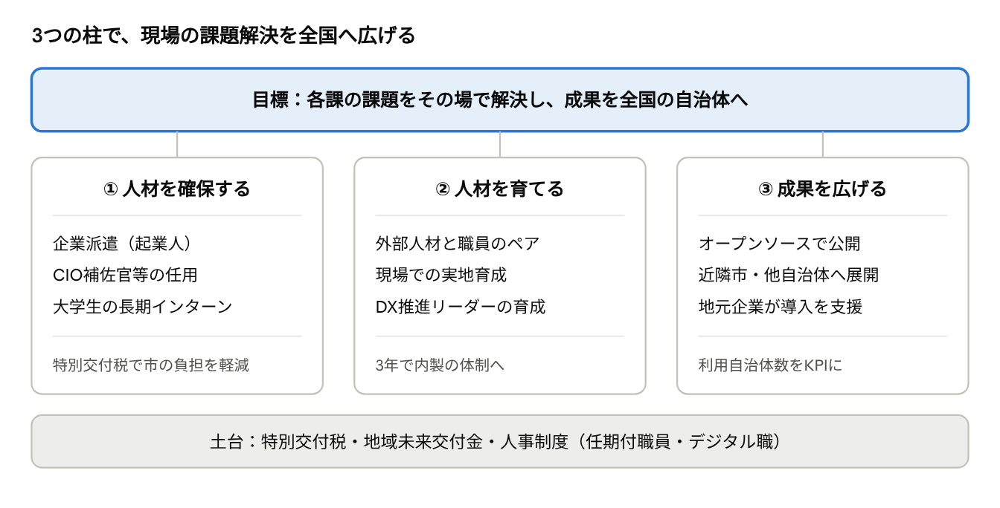
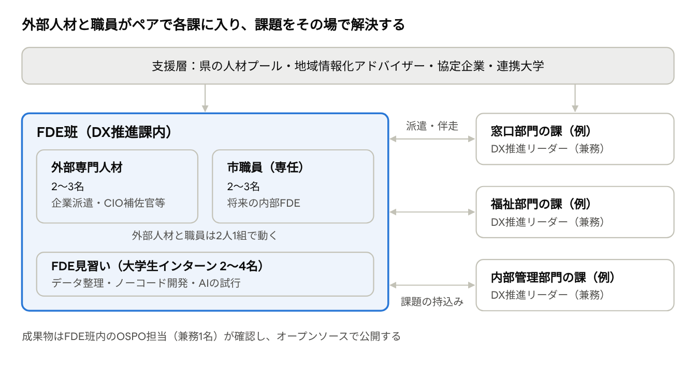
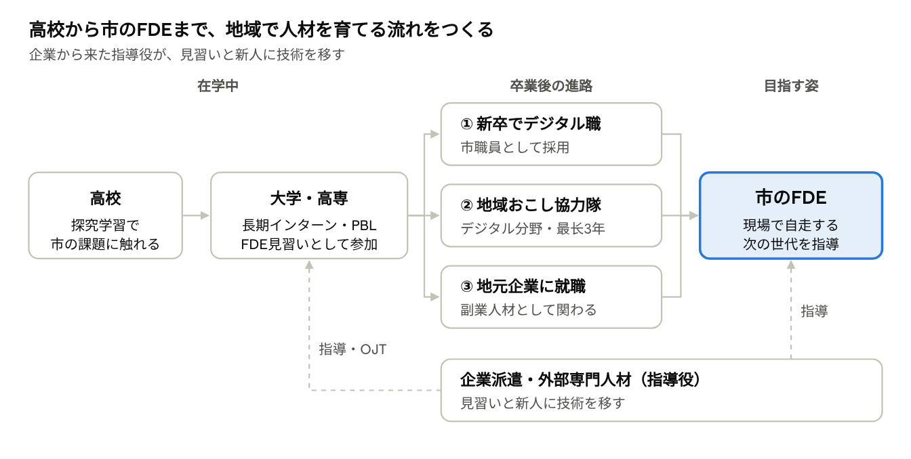
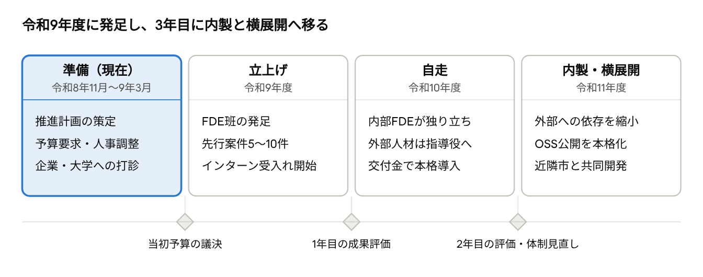

# 市役所FDE（フォワード・デプロイド・エンジニア）推進体制 企画案

2026年11月14日時点 · 庁内協議用たたき台

> 編集・コメントはオンライン版（Claude Docs）でも可能です。本ファイルはその書き出し版です。

## 1. 企画の概要

令和9年度に、DX推進課内へ「FDE班」を設置する。外部の専門人材・市職員・大学生インターンがチームを組み、各課の現場で業務課題をその場で解決する。作ったシステムはオープンソースとして公開し、他自治体にも広げる。人件費は国の特別交付税措置を最大限活用し、市の実質負担を抑える。

**FDE（フォワード・デプロイド・エンジニア）とは**：各課の現場に入り込み、業務課題をデータ・AI・ノーコード・システム改修で解決し、定着するまで伴走する技術職。外部ベンダーへの発注ではなく、職員と一緒に「その場で作って直す」ことが特徴。

**背景**

- 人口5万人以下の小規模団体のうち211団体が、DX担当1人以下の「1人情シス」状態にある（総務省）。外部委託だけでは現場の細かな課題に手が回らない。
- 国は外部デジタル人材の任用、企業人材の派遣、職員育成に特別交付税措置を講じており、人材確保の財源を組みやすい。
- デジタル庁は2026年4月に職員向け生成AI環境「源内」の一部をオープンソースで公開した。自治体による重複開発の抑制は国の方向性と一致する。

**3つの柱**：①人材を確保する（企業派遣・外部人材・学生）、②人材を育てる（ペアでの実地育成）、③成果を広げる（オープンソース公開と横展開）。

3つの柱は国の財源と人事制度を土台にし、「確保した人材を育て、その成果を外へ広げる」順につながる。

## 2. 組織体制

FDE班は「小さな中核チーム＋各課の兼務リーダー」で構成し、外部人材と市職員をペアにして各課へ派遣する。初年度は専任5〜6名、学生2〜4名を想定する。

FDE班が各課に入り、各課のDX推進リーダーが課題を持ち込む。双方向のやりとりを支援層が外から支える。（図中の課名は例）

| 層 | 構成（初年度の想定） | 役割 |
| --- | --- | --- |
| FDE班（DX推進課内） | 外部専門人材2〜3名＋市職員（専任）2〜3名 | 案件の選定、各課への派遣、技術的な判断、育成の運営 |
| FDE見習い | 大学生の長期インターン2〜4名 | データ整理、ノーコード開発、AIの試行 |
| 各課 | DX推進リーダー（兼務、各課1名） | 課題を持ち込む、FDEと一緒に作る、完成後に運用する |
| 支援層 | 県の人材プール、地域情報化アドバイザー、協定企業、連携大学 | 専門的な助言、高度な案件の補完 |

**運営のルール**

- 外部人材と市職員は必ずペアで動き、仕事をこなしながら技術を移す。
- 案件は「3か月以内に効果が出るもの」から始める。例：申請の受付業務、窓口の待ち時間対策、議事録作成、問合せ対応へのAI導入。
- 案件の受付基準を決め、何でも頼まれる「便利屋」にしない。基準例：削減できる時間、市民への影響、他課へ横展開できるか。
- FDE班内にオープンソース公開の担当（OSPO、兼務1名）を置く。

## 3. 人材確保

人材は「企業から来た人が教える、学生が手を動かす、市職員が現場をつなぐ」の3系統で確保する。企業派遣は全国で実績があり、令和6年度は871人が439団体で活用されている。

学生は在学中に見習いとして実務を経験し、卒業後は3つの進路のいずれかで市に関わり続ける。奨学金の返還支援を組み合わせれば、地元に戻るきっかけになる。

| 役割 | 人材の出どころ | 使う制度 | 主な財源 |
| --- | --- | --- | --- |
| 技術リーダー・指導役 | IT企業・SIer・地元企業からの派遣 | 地域活性化起業人（企業派遣型・副業型・シニア） | 特別交付税 |
| 技術リーダー | 民間の専門人材 | CIO補佐官等として任用（任期付・非常勤） | 特別交付税 |
| 各課と外部をつなぐPM | 民間の実務経験者 | 地域プロジェクトマネージャー | 特別交付税 |
| 内部FDE | 市職員（専任） | DX推進リーダー育成 | 一般財源＋育成経費は特別交付税 |
| FDE見習い | 大学生・高専生 | 有償の長期インターン（会計年度任用）、大学連携プロジェクト | 一般財源、大学連携の特別交付税 |
| 将来の担い手 | 新卒・地域おこし協力隊・Uターン | デジタル職の採用区分、協力隊、奨学金返還支援 | 協力隊は特別交付税 |

**企業への訴求点**：社員が現場の課題を一から解決する経験を積める。自治体向け事業の知見が得られる。ESG・地域貢献の実績になる。シニア社員を活用できる。

**学生受入れの条件**：指導役を必ずつける。個人情報に触れない業務から始める。有償とする。案件を3か月程度で区切り、引き継ぎ資料を残す。

**人事制度で用意するもの**：特定任期付職員の採用枠、副業・兼業人材の受入れ規程、デジタル職の採用区分と専門職のキャリアパス。育てた職員が異動で抜けない仕組みが最重要。

## 4. 財源

人の費用は特別交付税措置、成果物の本格導入は地域未来交付金（デジタル実装型）と、財源を分けて組む。令和8年度の上限額・措置率は確定版を未確認のため、下表は直近の公表値である。

| 制度 | 所管 | 内容（直近の公表値） | 本企画での用途 |
| --- | --- | --- | --- |
| [CIO補佐官等の外部人材任用](https://www.soumu.go.jp/main_content/001092501.pdf) | 総務省 | 特別交付税。措置率0.7（令和5〜7年度）、1団体3名分まで | FDE班の技術リーダー |
| [地域活性化起業人](https://www.soumu.go.jp/main_content/001069411.pdf) | 総務省 | 特別交付税。受入れ経費の上限590万円/人（令和7年度拡充案） | 企業からの技術者派遣 |
| [地域プロジェクトマネージャー](https://www.soumu.go.jp/main_content/001092485.pdf) | 総務省 | 特別交付税。市町村2人、1人3年まで。上限は資料により650〜700万円/人 | 各課との調整役 |
| [DX推進リーダー育成](https://www.soumu.go.jp/main_content/001097739.pdf) | 総務省 | 育成経費が特別交付税の対象（令和8年9月資料） | 内部職員の研修・資格取得 |
| [大学と地域が連携した課題解決プロジェクト](https://www.soumu.go.jp/main_content/001053714.pdf) | 総務省 | 特別交付税（2024年度新設） | 大学・高専との共同プロジェクト |
| [地域未来交付金（デジタル実装型）](https://web.pref.hyogo.lg.jp/kk26/koufukin_digital.html) | 内閣府 | 旧「新しい地方経済・生活環境創生交付金」。TYPE1・TYPE V・TYPE S | 成果物の本格導入（人件費は原則対象外） |
| 地域情報化アドバイザー | 総務省 | 専門家の派遣 | 立ち上げ期の助言 |

**費用の試算（人件費のみ・概算）**

| 項目 | 人数 | 単価（万円/年） | 総額（万円） | 措置の見込み | 市の実質負担（万円） |
| --- | --- | --- | --- | --- | --- |
| 外部専門人材（CIO補佐官等） | 3 | 700 | 2,100 | 措置率0.7 | 約630 |
| 学生インターン（時給1,200円×週16時間×45週） | 4 | 約86 | 約345 | なし（大学連携部分は要確認） | 約345 |

上表の単価・時給は仮置きである。特別交付税は後から算定され、確約ではない。1人あたりの対象上限等もあるため、財政課と算定見込みを事前に調整する。

## 5. オープンソース公開と横展開

FDE班が作ったシステムは、開発の最初から公開を前提に作り、オープンソース（MITまたはApache-2.0）として公開する。総務省は、自治体が開発したソフトウェアをオープンソース化して他自治体に使わせることに、地方自治法上の制約はないと整理している（[総務省資料](https://www.soumu.go.jp/main_content/001054971.pdf)）。

公開した成果が他自治体で使われると、その実績が次の人材確保と交付金申請の根拠になり、さらに多くの課題を解決できるようになる。

**立場ごとの評価の見通し**

| 立場 | 見通し | 理由 |
| --- | --- | --- |
| 国の政策 | 方向性が合う | デジタル庁がオープンソース化の検討会を設置（2025年11月）、「源内」を公開（2026年4月） |
| 交付金・表彰の審査 | 加点が期待できる | 横展開の具体的な根拠になる（各年度の要綱で要確認） |
| 他自治体 | 関心は高い | 「誰がサポートするのか」が導入の障害 |
| エンジニア・学生 | 採用に大きく効く | 公開コードが求人票になり、学生にとっては実績になる |
| 地元企業・ベンダー | 受け止めは分かれる | 既存業務が減る懸念と、他自治体への導入支援という商機の両面 |
| 議会・住民 | 説明すれば理解を得やすい | 「税金で作ったものを全国の役に立てる」。保守費は問われる |

**著作権の整理（公開の前提）**

| 作った人 | 著作権の扱い | 必要な対応 |
| --- | --- | --- |
| 市職員（任期付・会計年度任用を含む） | 職務著作として原則市に帰属 | 内規で明確化 |
| 企業からの派遣者 | 協定の内容による | 派遣協定に市への帰属と公開への同意を明記 |
| 学生インターン | 雇用なら職務著作、PBLなら学生・大学に帰属しうる | 雇用契約または大学との協定で同意を得る |
| 委託先ベンダー | 契約の内容による | 仕様書に公開と著作権の譲渡を明記 |

**公開の運用ルール**：保守の方針を明示する。認証情報や庁内ネットワークの構成を含めない。公開前にシークレットのスキャンを行う。導入手順書とデモを用意する。導入・保守は民間企業に発注できると明示する。

## 6. ロードマップとKPI

令和8年度中に準備と令和9年度当初予算の要求を行い、令和11年度末までに外部への依存を減らした内製体制へ移行する。

各フェーズの境目（◇）で成果を評価し、次の段階に進むかどうかを判断する。

**KPI（目標値は協議で設定）**

| 分野 | 指標 |
| --- | --- |
| 業務改善 | 削減した業務時間（時間/年）、解決した案件数 |
| 市民サービス | 手続き・窓口の所要時間の短縮 |
| 人材 | 独り立ちした内部FDEの人数、インターン受入れ数、卒業後に市や地元に残った人数 |
| 内製化 | 内部で開発した割合 |
| 横展開 | 公開したリポジトリ数、利用自治体数、外部からの改善提案数 |

## 7. リスクと対策

最大のリスクは「財源が確約されないこと」と「育てた人材や知識が異動・退任で失われること」である。

| リスク | 対策 |
| --- | --- |
| 特別交付税は後から算定され、確約がない | 初年度は措置なしでも成り立つ規模で計画する。財政課と事前に算定見込みを調整する |
| 制度の名称・上限が毎年変わる | 毎年の地方財政の通知を確認する担当を決める |
| 外部人材が辞めると知識が残らない | 市職員とのペア制、作業記録の義務化、コードと手順の庁内保管 |
| 育てた職員が異動で抜ける | デジタル職の採用区分と専門職のキャリアパスを人事課と設計する |
| FDE班が何でも頼まれる「便利屋」になる | 案件の受付基準を定め、優先順位を公開する |
| 派遣元企業との調達上の利益相反 | 派遣者を派遣元が関わる調達に関与させないと協定に明記 |
| 情報セキュリティ・個人情報 | ネットワーク分離の方式の見直し、生成AI利用ガイドライン、学生は個人情報を扱わない業務から |
| 公開しただけで保守されないと批判される | 保守方針の明示、近隣市との共同開発・共同保守 |
| 既存ベンダーからの反発 | 導入・保守は民間に発注できると明示し、地元企業を導入パートナーにする |

## 8. 庁内協議で決めたい論点と次のアクション

令和9年度当初予算に間に合わせるには、下の論点を早期に決める必要がある。

**論点**

1. FDE班の置き場所：DX推進課内の班か、市長直轄のチームか
2. 初年度の規模：外部人材・市職員・学生それぞれ何名か
3. 外部人材の入れ方：企業派遣（起業人）、CIO補佐官等としての任用、副業人材のどれを軸にするか
4. 人事制度：特定任期付の採用、デジタル職の採用区分、副業受入れ規程をどこまで整えるか
5. 先行案件：最初に取り組む課の案件を5〜10件選ぶ
6. オープンソース公開の方針：公開を原則とするか、案件ごとに判断するか
7. 広域連携：近隣市との共同任用・共同開発を初年度から打診するか

**次のアクション**

- [ ] 地域活性化起業人（企業派遣型）の受入れ要件を照会する。岐阜県は制度上「名古屋圏（三大都市圏）」に含まれるため、市内の過疎地域等の有無で可否が変わりうる（総務省または県へ）
- [ ] 財政課と特別交付税の対象経費と算定見込みを調整する
- [ ] 人事課と任期付職員・会計年度任用職員の枠を調整する
- [ ] 近隣の大学・高専（情報系・データサイエンス系）にインターンと連携を打診する
- [ ] 派遣を依頼する候補企業をリストアップする
- [ ] 各課から先行案件の候補を募る
- [ ] 令和9年度当初予算の要求資料を作成する

## 出典

- [総務省 AX/DX推進体制の充実・強化とデジタル人材の確保・育成（令和8年9月）](https://www.soumu.go.jp/main_content/001097739.pdf)
- [総務省 外部人材任用・特別交付税措置](https://www.soumu.go.jp/main_content/001092501.pdf)
- [総務省 地域活性化起業人 実績（令和6年度）](https://www.soumu.go.jp/main_content/001070541.pdf)
- [総務省 地域活性化起業人 制度資料](https://www.soumu.go.jp/main_content/001069411.pdf)
- [国交省 資料（起業人上限の拡充）](https://www.mlit.go.jp/2chiiki_pf/files/250115_document04.pdf)
- [総務省 地域プロジェクトマネージャー](https://www.soumu.go.jp/main_content/001092485.pdf)
- [総務省 大学連携・地域外人材関連資料](https://www.soumu.go.jp/main_content/001053714.pdf)
- [兵庫県 地方未来交付金（デジタル実装型）](https://web.pref.hyogo.lg.jp/kk26/koufukin_digital.html)
- [福島県 地域未来交付金](https://www.pref.fukushima.lg.jp/sec/11045a/chiikimirai.html)
- [総務省 自治体ソフトウェアのオープンソース化に関する整理](https://www.soumu.go.jp/main_content/001054971.pdf)
- [IPA 行政機関のOSS活用 調査報告 2025](https://www.ipa.go.jp/digital/kaihatsu/oss/report/govoss_report_2025/index.html)
- [デジタル庁 「源内」公開](https://www.digital.go.jp/news/907c8e5d-2f4f-4bd7-9400-37c9f4221d7d)

本書の制度情報はWeb検索で確認した直近の公表値である。令和8、9年度の確定値は総務省・内閣府の最新通知で確認すること。
