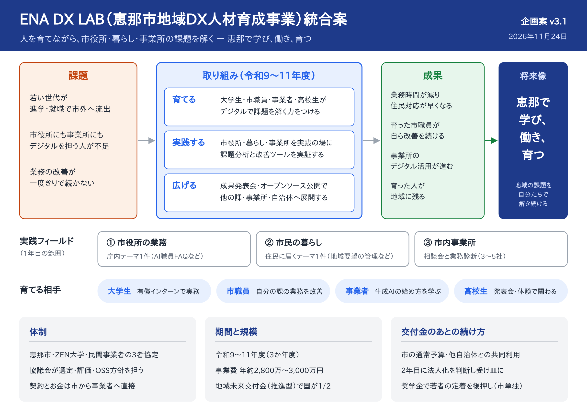
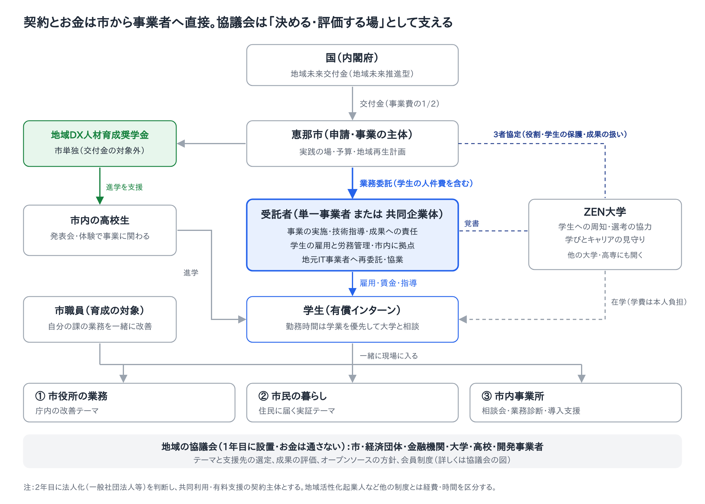
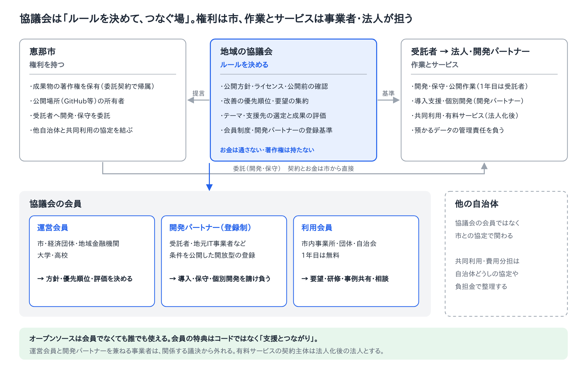
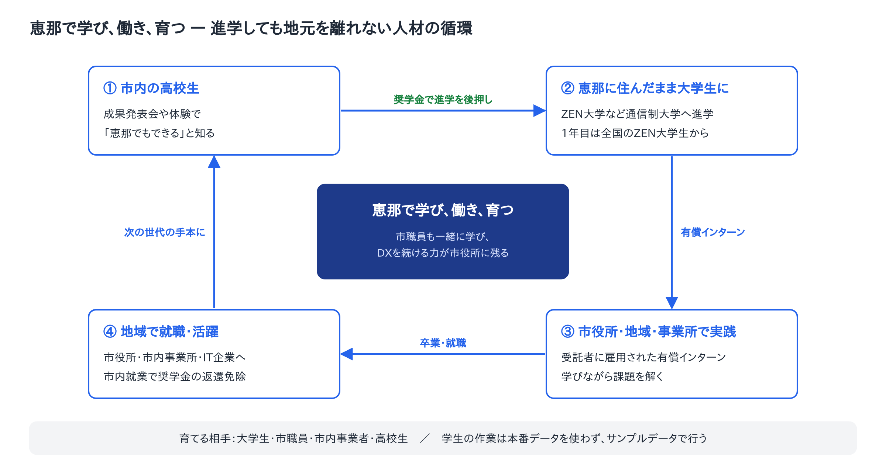
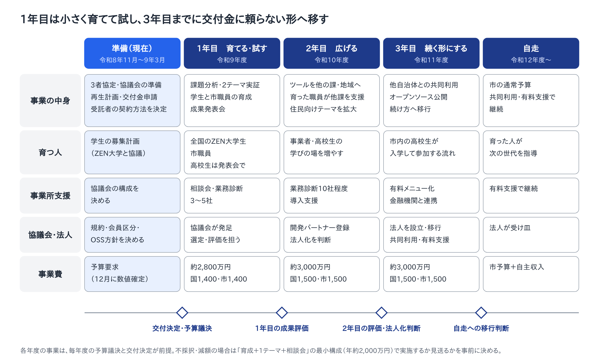

# ENA DX LAB（恵那市地域DX人材育成事業）企画案 統合案

版：v3.1（2026年11月24日） · 庁内協議用たたき台

> 本案は、恵那市地域DX人材育成事業（ENA DX LAB）の事業概要と、株式会社サステナの「地域未来交付金の活用に向けた事業の組み立て」（2026年11月20日協議用たたき台）を骨格とし、地域AX推進事業案（v2.0）の強みを加えた統合案である。比較の経緯は `kentou-memo.md` の11章、実施体制（協議会・法人化）の検討は12〜14章を参照。

## 1. 企画の概要

令和9〜11年度の3か年度、地域未来交付金（地域未来推進型、補助率1/2）を活用し、事業費年約2,800万〜3,000万円で実施する。恵那市・ZEN大学・民間事業者の3者協定を土台に、大学生・市職員・市内事業者・高校生がデジタルで課題を解く力を身につける。実践の場は市役所の業務、市民の暮らし、市内事業所の3つとし、1年目から小さく始める。育った人が地域に残り、改善を自分たちで続けられる状態をつくる。契約とお金の流れは市から事業者へ直接とし、地域の協議会は「決める・評価する場」として事業を支える。2年目に法人化を判断し、交付金の後の受け皿とする。

**事業コンセプト**：「人材育成 × 行政DX × 地域産業DX」。行政DXを単独で進める事業ではなく、人材育成を中心に据え、行政と地域産業の課題解決につなげる。

**目指す姿**：「恵那で学び、働き、育つ」人材の循環ができ、地域の課題を自分たちで解き続けられる。

**v2.0（地域AX推進事業案）からの主な変更点**

| 項目 | v2.0 | v3.0（統合案） |
| --- | --- | --- |
| 事業の中心 | 地域の課題解決（AX） | 人材育成を中心に、行政DX・地域産業DXにつなげる |
| 交付金での位置づけ | 地域未来推進型（委託事業） | 地域未来推進型（対象事業に明記された「人材の育成及び確保」として申請） |
| 実施体制 | 公募で選ぶ推進事業者 | 恵那市・ZEN大学・民間事業者の3者協定。受託者の契約方法は市が決める |
| 育てる相手 | 主に学生 | 大学生・市職員・市内事業者・高校生 |
| 対象の範囲 | 1年目から3領域を本格実施 | 1年目は市役所の2テーマ＋事業所の相談会・診断から小さく始める |
| 事業規模 | 初年度約5,230万円 | 年約2,800万〜3,000万円（他市の採択例と同程度） |
| 若者の定着策 | 奨学金の返還支援に言及 | 地域DX人材育成奨学金（市単独）を連動 |
| 協議会の役割 | 支援先の推薦・成果の評価 | 選定・評価に加え、オープンソースの方針と会員制度を担う。お金は通さない（v3.1） |
| 交付金後の受け皿 | 推進事業者の自走 | 2年目に法人化（一般社団法人等）を判断（v3.1） |

## 2. 背景と課題

- 国の調査では2030年までに最大79万人のIT・デジタル人材が不足すると推計され、IPAの調査ではDX推進人材が不足していると答えた企業が85％を超える。地域企業や自治体では、都市部より人材確保がさらに難しい。
- 恵那市の課題：
    1. 若い世代が進学・就職で市外へ出ていく
    2. 行政DXと地域企業のDXを担う人材が足りない
    3. 業務改善が一度きりで続かず、属人的になりやすい
- 課題の裏づけとなる数字は、市の統計で示す（申請書作成時に整理）。

## 3. 事業の内容

### 3.1 3つの取り組み

| 取り組み | 内容 |
| --- | --- |
| 育てる | 大学生・市職員・市内事業者・高校生が、業務分析、生成AIの活用、改善ツールづくりを実践で学ぶ |
| 実践する | 市役所・市民の暮らし・市内事業所を実践の場に、課題分析と改善ツールの試作・実証を行う |
| 広げる | 成果発表会を開き、他の課・市内事業所・他自治体へ展開する。開発したツールはオープンソースで公開する |

### 3.2 育てる相手

| 相手 | 身につけること | 実践の場 |
| --- | --- | --- |
| 大学生（ZEN大学ほか） | 業務分析、生成AIの活用、アプリ開発 | 市役所の課題分析と改善ツールの試作（有償インターン） |
| 市職員 | 自分の課の業務を見直し、ツールで改善する力 | 自分の課の業務。学生・受託者と一緒に |
| 市内事業者 | 生成AIと業務改善の事例、始め方 | 相談会・業務診断、成果発表会、試作したツールの体験 |
| 高校生 | 地域の課題をデジタルで解く体験 | 成果発表会、恵那未来キャンパス等と連携した体験 |

市職員の育成は、職員の仕事を置き換えるものではなく、手間を減らして住民に向き合う時間を増やすための取り組みとする。対象の課と職員の人数・時間は、現場の負担を見ながら決める。

### 3.3 実証テーマ（1年目は2テーマ）

住民に届くテーマを1つ、市職員の育成の題材になる庁内テーマを1つ組み合わせる。候補は以下（担当課との調整が前提）。

| 効果が届く先 | 候補テーマ |
| --- | --- |
| 住民・地域 | 地域要望・対応履歴の管理（13地域の住民・自治会）、自治会の電子回覧板 |
| 申請する人 | 補助金の申請・交付管理、後援・共催の申請管理 |
| 庁内 | AI職員FAQ、AI議事録・相談記録、防災備蓄品の管理 |

学生の作業は本番のデータを使わず、サンプルのデータで行う。

### 3.4 市内事業所への支援（1年目から小さく始める）

ENA DX LAB事業概要では事業所支援は第2フェーズ（R11以降）だったが、本案では1年目から小さく始める。令和8年7月の募集では「産業クラスター・地場産業」の事業が優先採択されており、事業所支援を早く始めることで交付金の優先分野と結びつけやすくなる。

| 年度 | 内容 |
| --- | --- |
| 1年目（R9） | 生成AI活用の相談会、業務診断（3〜5社、協議会の推薦による） |
| 2年目（R10） | 業務診断10社程度、導入支援。成果事例を公開 |
| 3年目（R11） | 金融機関と連携した企業DX診断、有料メニュー化 |

支援先は協議会を通じて公募で募り、共通メニューで支援する。無料は相談・診断・基本的な導入までとし、個別開発は事業所の費用負担か国の補助金で行う。

## 4. 実施体制と事業スキーム

**契約とお金は市から事業者へ直接**とする。事業のお金は「国 → 恵那市 → 受託者 → 学生」の一本で、協議会には事業費を通さない。ZEN大学とは協定と覚書による連携とし、金銭のやり取りを前提としない対等なパートナーとして始める。

| 主体 | 役割 |
| --- | --- |
| 恵那市 | 申請・事業の主体。課題の提示、実践の場の提供、実証実験の実施、事業全体の統括、地域再生計画の作成。成果物の著作権を持ち、受託者と契約する |
| 受託者（単一事業者 または 共同企業体） | プロジェクト運営、技術指導、学生インターンの雇用と労務管理、システム開発支援、成果への責任。市内に活動の拠点を置き、地元IT事業者へ再委託・協業する |
| ZEN大学 | 学生への周知と選考への協力、教育プログラムの提供、学習とキャリアの見守り、高校生に大学を知ってもらう機会 |
| 学生 | 課題分析、システム開発、実証実験、成果発表（有償インターン） |
| 地域の協議会 | 意思決定と評価の場（5章）。お金は通さず、著作権も持たない |

### 4.1 契約の形：事業者の数で選ぶ

| | 単一の事業者 | 複数の事業者 |
| --- | --- | --- |
| 契約とお金 | 市 → 受託者に直接委託 | 市 → 共同企業体（代表事業者＋構成員）に一括委託。または代表受託者が他社へ再委託 |
| 協議会 | 選定・評価・オープンソースの方針（お金は通さない） | 同じ。加えて構成員の役割分担を確認する |
| 向いている状況 | 1社で技術・運営・学生の雇用まで担える | 生成AI・業務アプリ・事業所支援など、得意分野が分かれている |

**1年目の想定**：3者協議が進んでいる事業者への直接委託とし、地元のIT事業者は再委託や事業所支援の協業で参加する。2年目に参加を希望する事業者が増えていれば、次の契約を共同企業体の形にする。

協議会に事業費を流さない理由は次の3つである。任意団体の協議会は契約・雇用の主体として弱い。市の契約ルール（地方自治法234条）を協議会経由で避けていると見られるおそれがある。構成員どうしで仕事を割り振ると、利益相反や受注調整と見られるリスクがある。

### 4.2 体制の考え方

1. **ZEN大学が要**：オンラインの大学なので、高校を出て恵那に住んだまま大学生になれる。「進学＝市外へ出る」を変える入口になる。公平性を保つため、学びの場は他の大学・高専の学生にも開く。
2. **学生を守る**：1年目は学生の雇用を受託者に一本化する。学生の人件費は委託金額に含め、指導と労務管理の責任を受託者が持つ。学業を優先し、成果の責任は学生に負わせない。
3. **受託者の選び方を説明できるようにする**：契約方法（公募型プロポーザル、または随意契約）は市が決める。随意契約とする場合は、包括連携協定や3者協定にもとづく専門性など、理由を整理しておく。公募とする場合の評価基準の例：市内に拠点を置くこと、学生の雇用・労務管理の体制、大学との連携、地元事業者との協業、成果のオープンソース公開、交付金後の続け方の計画。
4. **1社への依存を防ぐ**：成果物の著作権を市に帰属させてオープンソースで公開し、仕様書に引き継ぎ資料の作成を入れる。協議会で毎年度評価し、3年目以降の契約は改めて競争にかけることも想定する。
5. **他の国の制度と経費を重ねない**：地域活性化起業人など他の制度の業務とこの委託の経費・時間を分けて管理する。起業人として派遣中の者は、この委託の仕様づくりに関わらない。

## 5. 地域の協議会

協議会は**「ルールを決めて、関係者をつなぐ場」**とし、権利を持つ主体やサービスを提供する主体にはしない。

| 役割 | 担い手 | 理由 |
| --- | --- | --- |
| 権利を持つ（著作権、公開の名義） | 恵那市 | 委託契約で成果物の著作権を市に帰属させる。任意団体の協議会は権利の主体として不安定 |
| ルールを決める（公開方針、優先順位、会員制度、選定・評価） | 協議会 | 市・事業者・経済団体・大学などが対等に話し合える |
| 作業とサービスを提供する（開発・保守・導入支援・共同利用） | 1年目は受託者、2年目以降は法人や登録した開発パートナー | 契約・責任・個人情報の管理には法人格のある主体が必要 |

### 5.1 協議会が担うこと

- テーマと事業所支援先の選定、成果の評価
- オープンソースの公開方針（ライセンス、公開する範囲、公開前の確認ルール）
- 改善の優先順位の決定と、利用者の要望の集約
- 外部からの改善提案の受け入れ方、保守体制の調整、利用事例の発信
- 会員制度と、開発パートナーの登録基準

運営経費は交付金の対象（地域未来推進型の「事業推進主体組成経費（協議会の設立等）」）で賄う。

### 5.2 会員の区分

オープンソースは会員でなくても誰でも使える。会員の特典はコードではなく「支援とつながり」とする。

| 区分 | 主な対象 | 役割・得られるもの |
| --- | --- | --- |
| 運営会員 | 市、経済団体、地域金融機関、大学、高校 | 方針・優先順位・評価を決める |
| 開発パートナー（登録制） | 受託者、地元のIT事業者など | 導入・保守・個別開発を請け負える事業者として名簿に載る。登録条件を公開した開放型 |
| 利用会員 | 市内事業所、団体、自治会 | 要望を出せる、研修・事例共有に参加できる、導入の相談ができる（1年目は無料） |

他の自治体は協議会の会員ではなく、市との協定で関わる。共同利用の費用分担は、自治体どうしの協定や負担金で整理する。

### 5.3 協議会のルール

- 規約に調達・選定のルールを定め、結果を公開する
- 運営会員と開発パートナーを兼ねる事業者は、関係する議決から外れる
- 外部の評価委員を入れる
- 協議会は会費を取らず、収益事業を行わない（1年目）。有料サービスは法人化後の法人、または開発パートナーが事業所と直接契約して提供する

## 6. 人材の循環と奨学金

1年目は全国のZEN大学生の参加から始め、市内の高校生の入学は2年目以降を想定する。市職員も一緒に学ぶことで、DXを続ける力が市役所に残る。

**地域DX人材育成奨学金（市単独事業、交付金の対象外）**

| 項目 | 内容（事業概要による） |
| --- | --- |
| 目的 | 地域DXを担う人材の育成と、地理的・経済的な理由で進学が難しい高校生の進学機会の確保 |
| 対象者 | 文部科学大臣認可の通信制大学への進学者、地域DX人材育成プログラムの参加者、卒業後に市内で働く意思のある者 |
| 貸与額 | 連携協定大学：年間40万円以内、その他の対象大学：年間20万円以内 |
| 返還免除 | 卒業後、市内事業所等で一定期間働いた場合 |

貸与額に大学による差があるため、特定の大学を優遇していると見られないよう、対象を通信制大学全般とすることを明確にする。教員・看護師・保育・介護分野の人材育成制度と同様に、「地域DX人材」を新たな地域基盤人材として位置づける。

## 7. 3か年度の道筋

| 年度 | 事業の中身 | 育つ人 |
| --- | --- | --- |
| 1年目（R9）育てる・試す | 課題分析、2テーマの実証、学生と市職員の育成、事業所の相談会・診断、成果発表会 | 大学生と市職員から始める。高校生・事業者は発表会と相談会へ |
| 2年目（R10）広げる | 実証したツールを他の課・地域へ。育った市職員が次の課を支える。住民向けテーマを拡大 | 市内の事業者・高校生向けの学びの場を増やす |
| 3年目（R11）続く形にする | 他自治体との共同利用、オープンソース公開、事業所向け有料メニュー化、法人への移行、交付金に頼らない続け方へ移行 | 市内の高校生が入学して参加する流れができる |

協議会は準備期間に規約・会員区分・オープンソースの方針を決め、1年目に発足する。2年目に開発パートナーの登録を始め、法人化を判断する。法人化する場合は3年目に設立・移行する。

推進型は「原則3か年度以内」の計画で申請できる。3年目の姿が、審査の観点「自立性」への答えになる。各年度の事業は毎年度の予算議決と交付決定が前提で、翌年度は約束されない。毎年度の契約とするか、債務負担行為とするかは市が決める。

## 8. 事業費と財源

### 8.1 年度別の事業費（概算）

| 年度 | 事業費 | 国費（1/2） | 市負担 |
| --- | --- | --- | --- |
| R9 | 約2,800万円 | 約1,400万円 | 約1,400万円 |
| R10 | 約3,000万円 | 約1,500万円 | 約1,500万円 |
| R11 | 約3,000万円 | 約1,500万円 | 約1,500万円 |
| 合計 | 約8,800万円 | 約4,400万円 | 約4,400万円 |

ENA DX LAB事業概要の業務委託額（R9・R10 各2,000万円、R11 3,000万円、計7,000万円）より約1,800万円多い。1年目から事業所支援と市職員・事業者・高校生の育成を加えるためである。奨学金は市単独事業として別枠とし、規模は協議で決める。

### 8.2 R9の内訳（案）

| 項目 | 内訳 | 金額（万円） |
| --- | --- | --- |
| プロジェクト運営 | 統括1名 | 800 |
| 技術指導・開発 | エンジニア1.5名相当 | 1,050 |
| 事業所支援のコーディネート | 0.5名相当（相談会・業務診断） | 300 |
| 学生インターンの人件費 | 4名×約88（時給1,300円×週15時間×45週） | 350 |
| 学びの場の運営・成果発表会 | 市職員研修、事業者向け相談会、高校生向け体験 | 150 |
| クラウド・生成AI利用料・拠点 | 一式 | 150 |
| 合計 | | 2,800 |

R10・R11は事業所支援を500万円に増やし、合計3,000万円とする。単価・人数は仮置きである。

### 8.3 他市の採択例との比較

株式会社サステナの資料によると、令和8年度に推進型で採択された人材育成・DX系の事業費は、茅野市（人口約5.6万人）3,590万円、塩尻市（約6.7万人）3,550万円、福知山市（約7.7万人）3,210万円、佐久市（約9.8万人）3,130万円、滝沢市（約5.6万人）1,114万円などである。恵那市（約4.8万人）の年約2,800万〜3,000万円は、この範囲に収まる。

### 8.4 財源の組み合わせ

| 財源 | 用途 | 備考 |
| --- | --- | --- |
| 地域未来交付金（地域未来推進型） | 本事業の委託費 | 補助率1/2。対象事業に「地域社会を担う人材の育成及び確保に資する事業」と明記。国の承認を受ければ交付決定前に着手可 |
| 市の一般財源 | 市負担分（1/2）、奨学金 | 市負担分への国の財政措置は要確認 |
| 企業版ふるさと納税（人材派遣型） | 2年目以降、企業からの専門人材の受入れ | 寄附企業を同じ事業の委託先にしない |
| 事業所自身が使う国の補助金 | 個別事業所のツール導入 | 受託者が申請を支援 |

デジタル実装型は、「地方公共団体の業務効率化が主目的とみられる事業」「庁内のみに止まるもの」「人材育成のみ」を対象外としているため、本事業には使わない。

## 9. 成果の道筋とKPI

| 段階 | 内容 |
| --- | --- |
| ① 活動 | 課題分析、実証、研修、相談会、成果発表会 |
| ② 直接の結果 | 改善ツールができる。学生・市職員・事業者・高校生が学ぶ |
| ③ 成果 | 業務時間が減る。住民への対応が早くなる。事業所のデジタル活用が進む。育った人が自分で改善を続ける |
| ④ 将来像 | 若い世代が恵那で学び、働き、地域に残る |

| 指標の種類 | 指標の案 |
| --- | --- |
| 成果（主な指標） | 業務の削減時間（年間延べ500時間を目安に、現状を測ってから決定）／育った市職員が自分で行った改善の件数／住民の要望への対応にかかる日数／業務診断した事業所のうち改善に着手した数／地域に定着・就職した人数 |
| 直接の結果 | 育成した人数（学生・市職員・事業者・高校生）、実証したテーマの数 |
| 活動の量 | 課題分析5件、改善提案5件、実証2件、事業所の業務診断3〜5社、発表会1回 など |

推進型では、KPIの達成状況を毎年度検証し、結果を公表することが求められる。定着・就職は3年間の追跡が前提になるため、測り方を先に決める。交付金のKPIと、委託契約の成果物・検収の条件は分けて定める。

## 10. 交付金のあとの続け方

| 方法 | 内容 |
| --- | --- |
| 市の通常の予算 | 庁内の改善と市職員の育成を、通常の業務・予算として続ける |
| 他自治体との共同利用 | 開発したツールを他自治体と共同で利用・保守し、費用を分担する |
| 事業所向けの有料支援 | 基本の相談は無料のまま、個別の開発・運用を有料化する（法人または開発パートナーが提供） |
| 法人化 | 2年目に一般社団法人（またはNPO法人）の設立を判断し、ツールの共同利用・有料支援・学生の雇用の受け皿とする。地域再生法の「地域再生推進法人」の指定も検討する |
| 他地域への導入支援 | オープンソースで公開したツールを他地域に導入する業務を受託者が受注する |
| 大学の学びとしての位置づけ | 大学の学びの一部になれば、学生が来続ける理由ができる（単位の認定は完成年度のあとに検討の余地） |

## 11. オープンソース公開

開発したツールとノウハウは、委託仕様書でオープンソース（MITまたはApache-2.0）での公開を定める。総務省は、自治体が開発したソフトウェアをオープンソース化して他の自治体に使わせることに、地方自治法上の制約はないと整理している。公開は、事業所支援が特定の会社への利益にならないことの担保にもなる。

| 項目 | 担い手 |
| --- | --- |
| 著作権・公開場所（GitHub等）の所有者 | 恵那市 |
| 公開方針・ライセンス・公開前の確認ルール・改善の優先順位 | 協議会 |
| 開発・保守・公開作業 | 1年目は受託者（市の委託）、2年目以降は法人または開発パートナー |

成果の帰属（市・受託者・学生・大学）は3者協定と委託契約で定める。公開物には、個人情報、認証情報、庁内ネットワークの構成を含めない。

### 11.1 法人化の判断（2年目）

| 法人化する場合の条件の例 | 法人の形 |
| --- | --- |
| 事業所向け有料支援の需要がある、他自治体との共同利用が始まる、複数の開発事業者が参加している | 一般社団法人（登記のみで設立でき、1〜2週間程度）を基本とし、NPO法人（申請から登記まで2か月〜2か月半）も比較する |

市長・議員が法人の役員になると兼業禁止の規定（地方自治法142条・92条の2）に触れるおそれがあるため、市はオブザーバーや協定の当事者にとどめる。交付金の期間中に交付金で作った仕組みを有料で提供する場合の収入の扱いは、内閣府・県に確認する。

## 12. リスクと対策

| リスク | 対策 |
| --- | --- |
| 不採択・減額 | 「育成＋1テーマ＋相談会」の最小構成（年約2,000万円）から段階で組み、規模を選べるようにする。不採択のときの扱い（縮小か見送りか）を先に決める |
| 交付決定の遅れ | 交付決定前の着手の承認を使うか、開始時期を遅らせるかを、予算の説明の段階で決める |
| 対象外の経費が出る | 細則を国・県に確かめ、庁内向けの経費など対象外になりうる部分の扱いを先に決める |
| 募集の優先分野と合わない | 事業所支援を1年目から行い、「働く場所の確保・地域の担い手・地場産業」と結びつけて書く。市の新規申請（原則10件まで）の中での優先順位も確認する |
| 受託者の選定の説明 | 契約方法を早期に決め、随意契約なら理由を、公募なら評価基準を整理する |
| 学生の参加が想定より少ない | 募集計画をZEN大学と早めに相談する。他の大学・高専にも開く。学生の人数にかかわらず受託者が成果に責任を持つ |
| 他の国費との重なり | 地域活性化起業人、地域おこし協力隊、既存事業の予算と経費を区分する |
| 奨学金の公平性 | 対象を通信制大学全般とし、選考基準を公開する |
| 1社への依存 | 著作権の市への帰属、オープンソース公開、引き継ぎ資料、協議会による毎年度評価 |
| 協議会が特定の事業者に仕事を回していると見られる | 協議会にはお金を通さない。開発パートナーは開放型の登録。利害関係のある会員は議決から外れる |
| 法人化後に法人が立ち行かない | 有料支援の需要と共同利用の見込みを2年目に確認してから法人化を判断する |
| 市職員の負担 | 対象の課と時間を現場の負担を見ながら決め、1年目は小さく始める |

## 13. 庁内協議で決めたい論点と次のアクション

**論点**

1. 類型：地域未来推進型で進めることでよいか。県・国への確認は誰がいつ行うか
2. 事業の柱：人材育成を中心に、行政DXと事業所支援を実践の場とする組み立てでよいか
3. 育成の対象に市職員を入れることを、庁内で受け入れられるか
4. 事業所支援を1年目から小さく始めるか（ENA DX LAB事業概要ではR11以降）
5. 事業規模：年約2,800万〜3,000万円とするか、最小構成（年約2,000万円）から始めるか
6. 期間と契約：3か年度の計画とするか。毎年度の契約か債務負担行為か
7. 受託者の契約方法：公募型プロポーザルか、随意契約か
8. 奨学金の規模と対象（通信制大学全般とするか）
9. 協議会の構成・会員区分・規約（調達・利益相反のルール）
10. 1年目は単一の事業者への直接委託とし、2年目に共同企業体の形を検討することでよいか
11. 2年目の法人化の判断基準と、法人の形（一般社団法人／NPO法人）

**次のアクション**

- [ ] 県・国に、推進型の細則（対象経費）、交付決定の時期、交付決定前の着手、市負担分への財政措置を確認する
- [ ] ZEN大学を交えた3者協議を開き、協定に書く内容（役割、学生の保護、成果の扱い、費用の扱い）の案を起こす
- [ ] 受託者の契約方法を決め、仕様書の案を作る
- [ ] 実証テーマ（住民向け1、庁内1）を担当課と調整する
- [ ] 商工団体・地域金融機関に、協議会への参加と事業所支援への協力を打診する
- [ ] 予算要求に必要な数値を確定する（12月中）
- [ ] 地域再生計画の認定申請を準備する（令和8年度は1月26〜28日に受付。令和9年度分の日程は未公表）
- [ ] 協議会の規約案（会員区分、調達・利益相反のルール、オープンソースの方針）を作る
- [ ] 協議会や法人化の扱い、交付金事業の収入の扱いを内閣府・県に確認する
- [ ] 市長・議員・職員の法人役員就任の可否を法務・人事担当と確認する
- [ ] 市議会への説明の要点を整理する（2月中旬）

## 出典

- 恵那市地域DX人材育成事業（ENA DX LAB）事業概要（提供資料）
- 株式会社サステナ「地域未来交付金の活用に向けた事業の組み立て」2026年11月20日協議用たたき台（提供資料）
- [内閣府 地域未来交付金について（令和8年10月）](https://www.chisou.go.jp/sousei/about/chiikimiraikoufukin/pdf/chiikimiraikoufukin_gaiyou.pdf)
- [内閣府 地域未来交付金（地域未来推進型）の制度概要](https://www.chisou.go.jp/tiiki/kankyo/pdf/02_kouhukingaiyou26.pdf)
- [内閣府 地域再生推進法人の概要（令和7年9月）](https://www.chisou.go.jp/tiiki/tiikisaisei/houjin/02_houjin_gaiyou_202509.pdf)
- [内閣府 企業版ふるさと納税（人材派遣型）](https://www.chisou.go.jp/tiiki/tiikisaisei/portal/pdf/jinzaihakengata.pdf)
- [総務省 自治体ソフトウェアのオープンソース化に関する整理](https://www.soumu.go.jp/main_content/001054971.pdf)

他市の採択例、交付金の対象事業・対象外の記載、募集の優先分野は、株式会社サステナの資料に記載された内閣府資料の引用による。申請前に公募要領・交付要綱の原文で確認すること。

## 改訂履歴

| 版 | 日付 | 内容 |
| --- | --- | --- |
| v1.0 | 2026年11月14日 | 初版「市役所FDE推進体制 企画案」。市役所内にFDE班を置き、特別交付税で人材を確保する案 |
| v2.0 | 2026年11月19日 | 「地域AX推進事業（仮称）企画案」に改訂。対象を市民生活と市内事業所へ拡大し、推進事業者への委託スキームと自走化計画を追加（`archive/v2.0/`） |
| v3.0 | 2026年11月23日 | ENA DX LAB案を骨格とする統合案。人材育成を中心に据え、3者協定・ZEN大学・奨学金を取り込み、事業所支援を1年目から開始。事業規模を年約2,800万〜3,000万円に修正。一目で分かる全体像など図を新規作成（`archive/v3.0/`） |
| v3.1 | 2026年11月24日 | 契約とお金は市から事業者へ直接とし、協議会を「決める・評価する場」に位置づけ。協議会の会員区分とオープンソース管理の役割分担、単一事業者／共同企業体の契約の形、2年目の法人化判断を追加。事業スキーム図・ロードマップを更新し、協議会の図を新規作成 |
